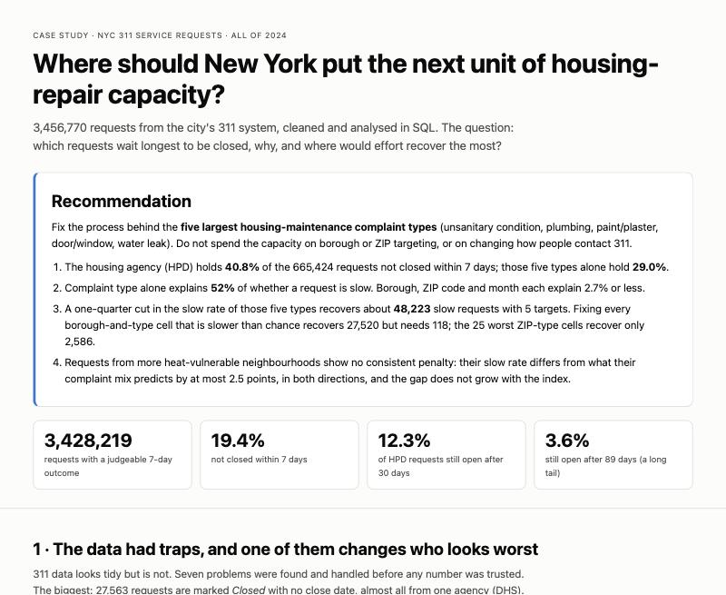
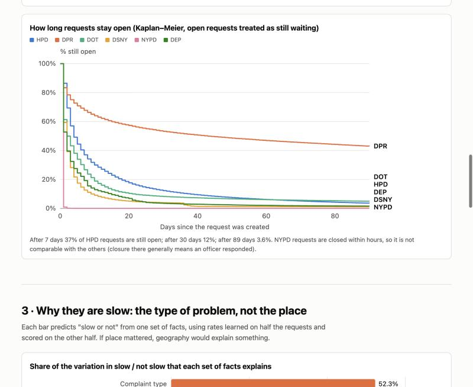
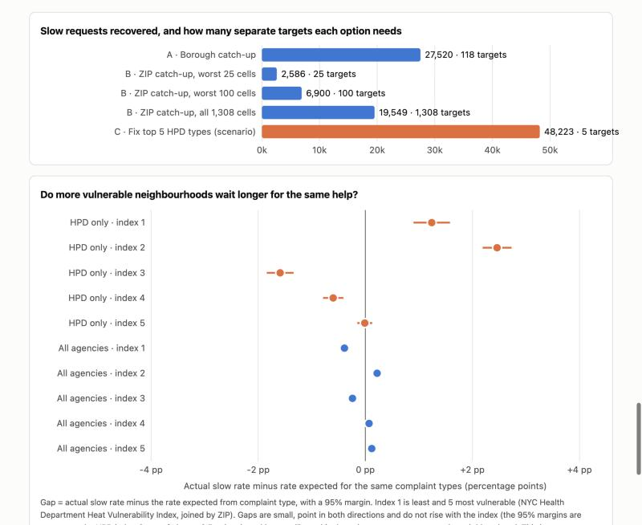

# NYC 311: where should the city put the next unit of housing-repair capacity?

An analysis of all 3,456,770 New York City 311 service requests created in 2024, built in SQL (DuckDB). It starts from messy
raw data and ends in a decision: **which requests wait longest to be closed, why, and where would effort recover the most.**

**[Open the decision page](docs/index.html)** (a single self-contained HTML file: download it or open it from a clone;
or enable GitHub Pages on the `/docs` folder to host it).



## The decision

**Fix the process behind the five largest housing-maintenance complaint types** (unsanitary condition, plumbing, paint/plaster,
door/window, water leak). Do not spend the capacity on borough or ZIP targeting, or on changing how people contact 311.

| Evidence | Result |
|---|---|
| Where the slow requests are | 19.4% of requests (665,424 of 3,428,219) were not closed within 7 days. The housing agency (HPD) holds **40.8%** of them; those five types alone **29.0%**. Ten agency and complaint-type pairs hold 45.7%; 27 of 204 hold 80%. |
| What explains slowness | Complaint type alone explains **52%** of whether a request is slow (scored on data not used to fit it). Borough 0.3%, month 0.1%, ZIP 2.7%. Adding borough, channel and month to type lifts it only to 55.9%. |
| What each option recovers | A one-quarter cut in the slow rate of the five types recovers about **48,200** slow requests with 5 targets. Fixing every borough-and-type cell slower than chance recovers 27,500 but needs 118 targets. The 25 worst ZIP-and-type cells recover 2,600. |
| Neighbourhood effect | Slow rates in more heat-vulnerable ZIPs differ from what their complaint mix predicts by at most 2.5 points, in both directions, and the gap does not grow with the index. |
| The long tail | 37% of HPD requests are still open after 7 days, 12% after 30 and 3.6% after 89 (Kaplan-Meier, open requests treated as still waiting). |





## The data had traps

311 data looks tidy and is not. Seven problems were found and handled before any number was trusted (`outputs/tables/r18_data_mess.csv`).
The one that changes the answer: **27,563 requests are marked "Closed" but have no close date**, 27,553 of them from the Department of
Homeless Services. Counted as open they add 27,563 slow requests (a 4% inflation of the slow total) and make DHS's slow rate read
3.8 times too high. They are treated as unknown and left out of every closure measure. The first version of this project got this wrong;
it was found while checking which agency really looked worst, and is now covered by a test.

Others: 988 close dates earlier than creation dates (excluded, never repaired), 2,638 "Unspecified" boroughs and 34,346 malformed
ZIPs (set to empty, never guessed), 266,984 requests with channel UNKNOWN (kept as its own value), and 35,632 requests genuinely still open
at the extract date (handled as censored in the survival curves).

## How it was built

```
Socrata API (one query per day) ─► data/raw/*.csv  ┐
NYC Health Dept heat index by ZIP ─► data/reference ┴► DuckDB: stage as text, type, de-duplicate
  ─► data-quality catalogue ─► 18 numbered SQL files ─► outputs/tables ─► docs/index.html (the decision page)
```

| Practice | Where |
|---|---|
| Every exclusion counted before analysis, with what it would have changed | `sql/02_data_quality.sql`, `sql/18_data_mess.sql` |
| Survival analysis with right-censoring (Kaplan-Meier in SQL: window functions over at-risk and event counts) | `sql/13_survival.sql` |
| Out-of-sample variance decomposition (fit on half the requests, score on the other half) | `sql/14_drivers.sql` |
| Expected-versus-actual standardisation with 95% margins, joined to a second source by ZIP | `sql/15_vulnerability.sql` |
| Recoverable-effort sizing with a chance margin so small-cell noise is not counted | `sql/16_recoverable.sql` |
| Window functions: `LAG`, rolling averages, running share, `RANK`, `NTILE`, percentiles | `sql/03` to `sql/11` |
| 27 tests on hand-computed answers, with mutation checks and a regression test for each mistake found | `tests/` |
| Independent recomputation of 29 headline numbers (including the survival curve and variance score) in pandas from the raw CSVs | `scripts/audit_headlines.py` |
| CI: SQL lint and tests on every push | `.github/workflows/ci.yml` |
| Choices and definitions written down | `docs/methodology.md`, `docs/data_dictionary.md` |

## Other findings

- **Housing dominates, but slow is not failing.** Some types are slow by design: new tree requests (99.7% not closed in 7 days),
  for-hire vehicle complaints (98.9%), helicopter noise (97.6%). Only 0.6% of requests carry a due date (DSNY: 44.3% of its dated requests
  were late), so fair per-type targets cannot be tested.
- **No sign of deterioration in 2024.** 88.7% to 92.9% of each month's requests closed within 30 days; the share still open at the extract
  date stayed between 0.6% and 1.5%; monthly volume rose 9.3% from January to December.
- **Intake channel is not the lever.** Mobile-app requests closed within 7 days 94.2% of the time against 74.8% for phone, but each
  channel closes at the rate its own complaint mix predicts (within 0.2 points for the three main channels).
- **Borough gaps exist inside a type.** Examples of boroughs many times slower than the agency's own citywide median: DOB general
  construction/plumbing in Staten Island (921 hours against 83), DPR maintenance or facility complaints in Queens (3,693 against 483),
  DHS encampment complaints in the Bronx (287 against 36.5). Full table: `outputs/tables/r08_borough_gaps.csv`.
- **Inside the five housing types** the biggest single slow problems are pests (40,475 slow requests, 64% slow), wall paint/plaster
  (18,030), doors (15,243), heavy water flow (12,413) and basin/sink plumbing (10,803).

| Agency | Requests | Closed within 7 days | Median hours to close | Share of all slow requests |
|---|---|---|---|---|
| HPD (housing) | 733,927 | 63.0% | 92.5 | 40.8% |
| DPR (parks) | 138,406 | 32.3% | 619.3 | 14.1% |
| DOB (buildings) | 102,817 | 41.9% | 371.5 | 9.0% |
| DOT (transportation) | 203,885 | 73.3% | 46.2 | 8.2% |
| DSNY (sanitation) | 306,147 | 87.3% | 30.3 | 5.8% |

Median hours use closed requests only, so they understate how long open ones take. The NYPD (1.5 million requests, 45% of the total)
closes a median request in 1.1 hours; its "closed" generally means police responded, not that the underlying problem was solved.

## Data and quality

- **Sources:** NYC Open Data 311 Service Requests (`erm2-nwe9`), requests created in 2024, pulled 7 November 2026 (extract date 4 November
  2026); the row count matches the API's own count taken before the download. NYC Health Department Heat Vulnerability Index by ZIP
  (`4mhf-duep`, 184 ZIPs), committed in `data/reference/` because it is small.
- 63,195 requests (1.8%) have no close date: 35,632 genuinely open and 27,563 marked closed (see above). 99.4% have no due date.

## Limitations

- **One year, one city.** No trend beyond 2024; a second year would show whether the same types stay slow.
- **Closure is an agency decision.** If HPD closes a request only when a landlord reports a fix, 7-day closure measures landlord behaviour
  and the fix would be enforcement rather than capacity.
- **7 days is arbitrary.** Used as a common yardstick; types differ legitimately in how long they take.
- **Associations, not causes.** The recovered-requests figure for the five types is a scenario (a quarter off the slow rate), not a forecast.
  The neighbourhood index is a published composite that includes income and race and is used only as a grouping.
- **The dataset changes.** Closed dates keep arriving, so a later pull can differ slightly. The tables here are from the pull dated above.

## Reproduce

```bash
make setup
make download   # about an hour; resumable, one file per day
make run        # build the warehouse and export outputs/tables
make charts
make site       # build docs/index.html
make check      # SQL lint and tests
make audit      # independent pandas recomputation
```
