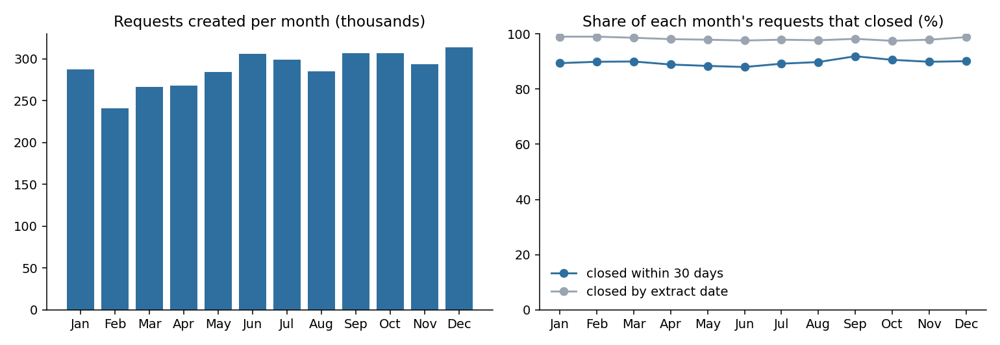
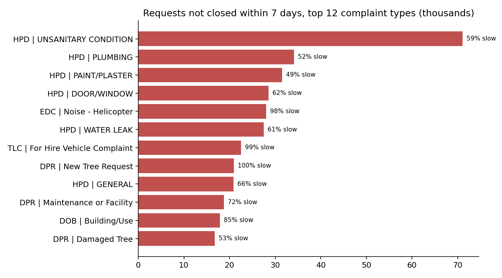

# NYC 311 service performance, 2024

SQL analytics on all 3,456,770 New York City 311 service requests created in 2024. The question: **where is the city slowest to
close requests, which complaint types and agencies account for most of the slow ones, and did anything get worse during the year?**

Built with DuckDB and plain SQL (11 numbered files, linted with SQLFluff), 15 automated tests, and an independent pandas audit
that recomputes 20 headline numbers straight from the raw files.

## Recommendation up front

1. **Start with housing maintenance.** 20.1% of requests were not closed within 7 days. The Department of Housing Preservation
   and Development (HPD) alone accounts for **39.2%** of those slow requests, and five HPD complaint types (unsanitary
   condition, plumbing, paint/plaster, door/window, water leak) account for **27.8%** of all of them. Ten agency and complaint-type
   pairs make up 45.1% of slow requests; 27 of 204 make up 80%.
2. **Do not read "slow" as "failing".** Some types are slow by design: new tree requests (99.7% not closed in 7 days), TLC
   for-hire vehicle complaints (98.9%) and helicopter noise (97.6%). Judging agencies fairly needs per-type targets, and the
   data has almost none: only 0.6% of requests carry a due date (one agency, DSNY, has enough to analyse; 44.3% of its dated
   requests were late).
3. **No sign of deterioration in 2024.** Between 88% and 92% of every month's requests closed within 30 days, and the share
   still open at the extract date stayed between 1% and 2.5%, while monthly volume rose 9% from January to December.
4. **The intake channel is not the lever.** Mobile-app requests closed within 7 days 92.2% of the time against 74.5% for phone,
   but each channel closes at the rate its own complaint mix predicts (actual minus expected is within a point for the three
   main channels). The difference comes from what people report on each channel, not from the channel.
5. **Place matters less than type.** The slowest tenth of ZIP codes have a 35.8% slow rate against 8.9% in the fastest tenth, but
   they hold only 11.2% of slow requests, against 45.1% for the ten leading complaint types. ZIP rates are not adjusted for
   complaint mix.



## Where the slow requests are



| Agency | Requests | Closed within 7 days | Median hours to close | Share of all slow requests |
|---|---|---|---|---|
| HPD (housing) | 733,927 | 63.0% | 92.5 | 39.2% |
| DPR (parks) | 138,406 | 32.3% | 619.3 | 13.5% |
| DOB (buildings) | 102,817 | 41.9% | 371.5 | 8.6% |
| DOT (transportation) | 203,886 | 73.3% | 46.2 | 7.9% |
| DSNY (sanitation) | 306,156 | 87.3% | 30.3 | 5.6% |

Median hours use closed requests only, so they understate how long open ones take. The NYPD, which handles 1.5 million requests
(45% of the total), closes a median request in 1.1 hours; its "closed" generally means police responded, not that the underlying
problem was solved, so closure times are not comparable across agencies.

**Borough gaps within an agency and type** (closed requests only, at least 200 per borough, citywide median of at least a day):
examples of boroughs many times slower than the agency's own citywide median are DOB general construction/plumbing in Staten
Island (921 hours against 83), DPR maintenance or facility complaints in Queens (3,693 against 483) and DHS encampment
complaints in the Bronx (287 against 36.5). Full table: `outputs/tables/r08_borough_gaps.csv`.

## How it was built

```
Socrata API (one query per day) ─► data/raw/*.csv ─► DuckDB: stage as text, type, de-duplicate
  ─► quality report ─► 9 analysis queries (window functions, percentiles, cohorts) ─► outputs/tables, outputs/charts
```

| Practice | Where |
|---|---|
| Every exclusion counted before analysis | `sql/02_data_quality.sql`, `outputs/tables/r02_data_quality.csv` |
| Window functions: `LAG`, rolling averages, running share, `RANK`, `NTILE`, percentiles | `sql/03` to `sql/11` |
| Tests on hand-computed answers, plus regression tests for each mistake found in review | `tests/` (15 tests) |
| Independent recomputation in pandas from the raw CSVs (20 checks, all pass) | `scripts/audit_headlines.py` |
| CI: SQL lint and tests on every push | `.github/workflows/ci.yml` |
| Choices and definitions written down | `docs/methodology.md`, `docs/data_dictionary.md` |

Reviewing the first real results caught three mistakes in my own queries, all now fixed and tested: a running "backlog" that
grew only because the file starts empty on 1 January; a borough baseline that mixed two agencies (it showed DHS encampment at
211 times the city median; the correct figure is 7.9); and a baseline that included requests the borough figures excluded.

## Data and quality

- **Source:** NYC Open Data 311 service requests, requests created in 2024, pulled 7 November 2026 (extract date 4 November 2026).
  The row count matches the API's own count taken before the download (3,456,770).
- 988 requests (0.03%) have a close date before their creation date and are excluded from durations; 27,563 (0.8%) are marked
  closed with no close date; 34,346 (1.0%) lack a valid ZIP; 63,195 (1.8%) were still open at the extract.
- 99.4% of requests have no due date.

## Limitations

- **One year, one city.** No trend beyond 2024, and no comparison with earlier years.
- **Closure means different things.** Each agency decides when to close a request; a quick close is not the same as a solved problem.
- **7 days is arbitrary.** Used as a common yardstick; types differ legitimately in how long they take.
- **Requests are not incidents.** 311 volumes reflect who reports and how, not true incidence, and are not scaled by population.
- **Associations, not causes.** ZIP and channel comparisons are unadjusted or only adjusted for complaint mix.
- **The dataset changes.** Closed dates keep arriving, so a later pull can differ slightly. The result tables in this repository are
  from the pull dated above.

## Reproduce

```bash
make setup
make download   # about an hour; resumable, one file per day
make run        # build the warehouse and export outputs/tables
make charts
make check      # SQL lint and tests
make audit      # independent pandas recomputation
```
